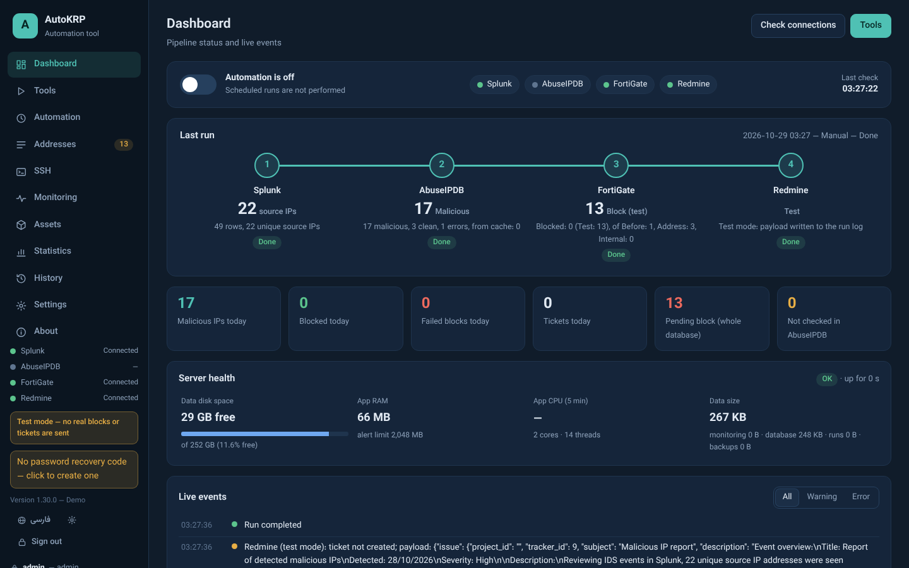

<div dir="rtl">

# AutoKRP

**خودکارسازی پاسخ امنیتی برای ویندوز** — Splunk ← AbuseIPDB ← FortiGate ← Redmine، به‌همراه ابزار SSH، مانیتورینگ شبکه و گاوصندوق رمزشده‌ی اعتبارنامه‌ها، در یک برنامه‌ی دسکتاپ یا وب چندکاربره.

[English](README.md) · **فارسی**



## امکانات

**روال پاسخ**
- اجرای کوئری Splunk، بررسی IPهای مبدأ در AbuseIPDB (با کش محلی و چند کلید API)، بلاک مخرب‌ها در FortiGate و ساخت تیکت Redmine.
- صفحه‌ی **ابزارها**: ابزارها (Splunk، AbuseIPDB، FortiGate، Redmine، DNS، SSH، اسکن شبکه، بررسی تکمیلی) به ترتیب کلیک اجرا می‌شوند و خروجی هرکدام به‌صورت **جدول** (CSV با نام ستون‌ها) ورودی بعدی است. هر ترتیب را می‌شود به‌عنوان **کار** ذخیره و زمان‌بندی کرد.
- **تأیید پیش از هر تغییر**: IPها، کارها یا درخواست‌ها اول نشان داده می‌شوند و هرکدام را نخواهید تیکش را برمی‌دارید. حالت تست به‌طور پیش‌فرض روشن است.
- رنج‌های مستثنا که هرگز بررسی یا بلاک نمی‌شوند؛ IP سرورهای خود برنامه خودکار اضافه می‌شود.

**FortiGate**
- چند دستگاه FortiGate، هرکدام با اتصال، توکن و پین گواهی جدا.
- بلاک دائم یا **موقت** (به روز): مدت را هنگام بلاک از فهرست آدرس‌ها انتخاب کنید (حتی برای IPهایی که الان بلاک‌اند)، یا قاعده بگذارید؛ مثلاً «کشور IR ← ۳۰ روز، بقیه دائم».
- **تسک پایتونی**: تابع `plan(fg, rows, ctx)` از دستگاه می‌خواند و کار «پیشنهاد» می‌دهد (ساخت Address، افزودن به گروه، ساخت پالیسی و …). برنامه درخواست‌ها را نشان می‌دهد و فقط تأییدشده‌ها را می‌فرستد. قالب آماده و اجرای آزمایشی دارد.
- به‌روزرسانی آفلاین امضاهای FortiGate با SSH/TFTP؛ سازنده‌ی دستور جستجوی لاگ برای CLI.

**ارتباط با دستگاه‌ها (SSH، Telnet، کابل کنسول)**
- کتابخانه‌ی اسکریپت با متغیر از خروجی ابزار قبلی؛ اجرا روی چند دستگاه؛ خروجی آخرین دستور به‌صورت CSV برای ابزار بعدی.
- پشتیبان‌گیری زمان‌بندی‌شده از کانفیگ با مقایسه‌ی نسخه‌ها و دانلود آخرین نسخه‌ی چند دستگاه در یک zip.
- ترمینال زنده در تب‌ها با SSH، Telnet یا کابل کنسول USB/سریال (پورت COM، فقط در حالت دسکتاپ، با Break)، MultiExec، دکمه‌های دستور ذخیره‌شده، جست‌وجو در متن ترمینال (Ctrl+Shift+F) و ذخیره‌ی لاگ کل نشست؛ انتقال فایل شبیه WinSCP (SFTP، SCP، FTP/FTPS، سرور TFTP موقت).
- دستگاه‌های Telnet در اجرای دستور و پشتیبان کانفیگ (Cisco و تجهیزات شبکه‌ی پشتیبانی‌شده در netmiko).
- ابزارهای شبکه: پیدا کردن محل اتصال IP/MAC (سوییچ و پورت، از جدول ARP و MAC با SNMP)، Traceroute، مالک IP (RDAP) و سازنده‌ی MAC (IEEE).
- **ابزار API**: اتصال‌های ذخیره‌شده (آدرس پایه و احراز Basic، Bearer یا API Key؛ اسرار در مخزن رمزشده)، GET/POST/PUT/PATCH/DELETE با پارامتر، هدر و Body، پاسخ JSON مرتب (کپی یا ذخیره‌ی فایل)، درخواست‌های ذخیره‌شده و لاگ درخواست‌ها در پایگاه داده (چه کسی، کی، چه چیزی؛ اسرار ماسک‌شده).

**مانیتورینگ و دارایی**
- مانیتورینگ Ping / TCP / HTTP با هشدار صوتی، مرورگر و ایمیل، پنجره‌ی نگهداری، گزارش و نمای NOC.
- **نقشه‌ی دستی شبکه** (بدون نیاز به LLDP): لینک پورت‌به‌پورت با رنگ بار، قرمز با قطع پورت یا دستگاه، زیرنقشه، نمای «فقط مشکل‌ها» و حالت مانیتور دیواری.
- **داشبوردهای ویجتی** شبیه OpManager و Zabbix: چند صفحه در هر داشبورد، ویجت‌های قابل جابه‌جایی و تغییر اندازه (وضعیت، مشکلات، نمودار ترافیک و مقدار، عقربه، Top-N، دسترس‌پذیری، نقشه، Trap/Syslog، ساعت، متن)، مشترک یا شخصی، نمایش خودکار صفحه‌ها و تمام‌صفحه.
- SNMP نسخه‌ی ۲c و ۳ (Cisco، FortiGate، Juniper، MikroTik، HP iLO، لینوکس و …): CPU، حافظه، دیسک، دما، فن، منبع تغذیه، ترافیک پورت‌ها، OID دلخواه، آستانه و نمودار بلندمدت؛ Trap و Syslog. خواندن در فرایندهای جدا (چند هسته)، «سیاست پایش» برای هر دستگاه (بازه، دقت ۱ یا ۵ دقیقه، مدت نگهداری، چه داده‌ای جمع شود) و ذخیره‌ی اختیاری داده‌ی نمودارها و Trap/Syslog در MySQL/MariaDB یا PostgreSQL. نمای کارت یا جدول با نماهای ذخیره‌شده برای هر کاربر، قالب نمایش دستگاه و داشبوردهای نام‌دار NOC (کاشی/جدول، نمودار uplink، چرخش خودکار) برای مانیتور دیواری.
- مدیریت دارایی از SNMP و SSH با تاریخچه‌ی تغییرات و تأیید ادمین.

**بقیه**
- داده‌ها در فایل رمزشده‌ی محلی (SQLCipher) یا روی سرور جدای **MySQL/MariaDB** یا **PostgreSQL نسخه‌ی ۱۶ به بالا** (داده‌ی فعلی خودکار منتقل می‌شود؛ ستون‌های حساس می‌توانند رمزشده بمانند).
- آمار، IPهای تکراری، تاریخچه‌ی کامل، اعلان ایمیلی، ابزارهای آفلاین (ماشین‌حساب ساب‌نت، هش، استخراج IOC، فهرست پورت‌ها و …).
- رابط انگلیسی و فارسی (دکمه‌ی زبان پایین نوار کناری).

## دانلود و اجرا

1. **`AutoKRP.exe`** را از [آخرین Release](https://github.com/kamyar-rp/AutoKRP/releases/latest) دانلود کنید.
2. (توصیه‌شده) SHA-256 فایل را با مقدار منتشرشده کنار Release مقایسه کنید: `Get-FileHash .\AutoKRP.exe -Algorithm SHA256`
3. اجرا کنید. فایل هنوز امضای دیجیتال ندارد و ممکن است SmartScreen هشدار بدهد: **More info ← Run anyway**.
4. در اولین اجرا **پوشه‌ی داده** و **حالت** را انتخاب کنید: **کلاینت** (دسکتاپ، یک کاربر) یا **سرور** (وب HTTPS چندکاربره با نقش‌های ادمین/اپراتور/فقط‌خواندنی).

برای دیدن برنامه بدون اتصال واقعی: `AutoKRP.exe --demo`.

> حالت تست پیش‌فرض روشن است: تا وقتی در «تنظیمات ← عمومی» خاموشش نکنید، بلاک، تیکت و تغییرات SSH فقط در گزارش اجرا نوشته می‌شوند.

## اجرا از سورس
پیش‌نیاز: ویندوز ۱۰/۱۱ و Python 3.11 یا بالاتر.
```bat
pip install -r requirements.txt
run_demo.bat
run.bat
build.bat            &rem می‌پرسد چه ساخته شود، سپس exe قابل‌حمل + فایل نصبی
build.bat full       &rem همه‌چیز، بدون پرسش
build.bat portable   &rem نسخه‌ی کامل، فقط exe قابل‌حمل
```

### ساخت ماژولار (انتخاب بخش‌های داخل exe)
```bat
build.bat monitor                   &rem فقط مانیتورینگ            -> dist\AutoKRP-Monitor.exe
build.bat monitor server            &rem فقط مانیتورینگ، فقط سرور   -> dist\AutoKRP-Monitor-Server.exe
build.bat sec+dev client portable   &rem امنیت + ارتباط با دستگاه‌ها، فقط کلاینت، بدون فایل نصبی
```
بخش‌ها: `sec` (امنیت: Splunk، AbuseIPDB، FortiGate، Redmine، DNS، اسکن، آدرس‌ها، کارهای خودکار)، `dev` (ارتباط با دستگاه‌ها: SSH/Telnet، پشتیبان کانفیگ، ترمینال، انتقال فایل، TFTP، ابزارهای شبکه، ابزار API)، `monitor` (مانیتورینگ، SNMP، Trap/Syslog، نقشه‌ها، داشبوردها، NOC)، `asset` (دارایی‌ها)، `offline` (ابزارهای آفلاین). حالت‌ها: `both` (پیش‌فرض؛ در اولین اجرا پرسیده می‌شود)، `client`، `server`.

همیشه در هر بیلد هست: ورود، کاربران و گروه‌ها، رمزنگاری و تنظیمات امنیت، پایگاه داده (محلی، MySQL/MariaDB، PostgreSQL)، تنظیمات عمومی، تاریخچه و لاگ ممیزی، کارهای من و پیام‌ها، اعلان‌ها، بررسی به‌روزرسانی، درباره، مجوز و سازنده.

بخشی که انتخاب نشده فقط پنهان نیست: کد موتور آن با stub خالی جایگزین می‌شود، اسکریپت‌هایش فرستاده نمی‌شود، متدهای API آن حذف می‌شود و کتابخانه‌هایش (مثلاً netmiko/paramiko بدون `dev`، pysnmp بدون `monitor`) داخل exe نمی‌آید. هر چیزی که یک بخشِ انتخاب‌شده از بخش دیگر لازم دارد می‌ماند. بیلد سفارشی نام خودش را دارد ولی از **همان پوشه‌ی داده** استفاده می‌کند و داده‌ی بخش‌های غایب دست‌نخورده می‌ماند. سورس اصلی تغییر نمی‌کند (کپی در `build\stage\`). جزئیات: `dev\mkbuild.py` و `autokrp\buildcfg.py`.

### فایل نصبی (ساخت از سورس)
در Release فقط `AutoKRP.exe` قابل‌حمل منتشر می‌شود. برای فایل نصبی (نصب در `C:\Program Files\AutoKRP`، منوی Start و حذف از تنظیمات ویندوز):
1. ابزارهای ساخت را طبق [vendor/README.md](vendor/README.md) در پوشه‌ی `vendor\` بگذارید: نصب‌کننده‌ی Python 3.14 (فقط اگر Python 3.14 نصب نیست) و نصب‌کننده‌ی Inno Setup 6.3 یا 7 (فقط اگر نصب نیست). چیزی برای کل سیستم نصب نمی‌شود.
2. `build.bat` را اجرا کنید؛ خروجی `dist\AutoKRP-Setup-X.Y.Z.exe` است.

نسخه‌ی نصبی **با همان داده‌های قبلی ادامه می‌دهد**: همان پوشه‌ی داده‌ی exe قابل‌حمل برای همان کاربر ویندوز. نسخه‌ی در حال اجرا پیش از نصب بسته می‌شود و حذف برنامه داده‌ها را پاک نمی‌کند. اگر اجرای خودکار سرور با exe قابل‌حمل ساخته شده، پنجره‌ی سرور گزینه‌ی «به‌روزرسانی به همین نسخه» را نشان می‌دهد.

## امنیت
همه‌ی داده‌ها روی دیسک رمزشده‌اند. با «رمز اصلی» (کلاینت) یا در حالت سرور، بدون رمز هیچ داده‌ای باز نمی‌شود، حتی با نسخه‌ی تغییر‌یافته از سورس؛ مگر «باز شدن خودکار» روشن باشد. جزئیات: [SECURITY.md](SECURITY.md) و [شرح کامل فارسی](docs/security-design.fa.md).

## گزارش مشکل و پیشنهاد
- مشکل: [گزارش باگ](https://github.com/kamyar-rp/AutoKRP/issues/new?template=bug_report.yml)
- پیشنهاد: [درخواست قابلیت](https://github.com/kamyar-rp/AutoKRP/issues/new?template=feature_request.yml) یا [Discussions](https://github.com/kamyar-rp/AutoKRP/discussions)
- مشکل امنیتی: خصوصی، طبق [SECURITY.md](SECURITY.md)

## مجوز
[MIT](LICENSE) — © 2026 Kamyar RP. ساخته‌شده با کمک Claude (Anthropic).

</div>
