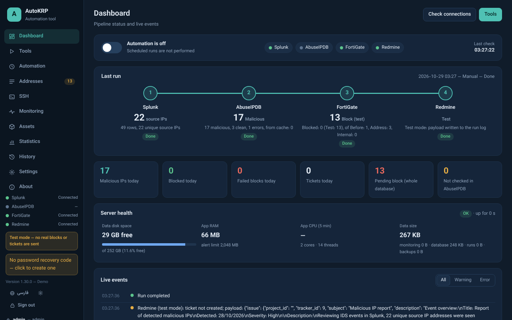
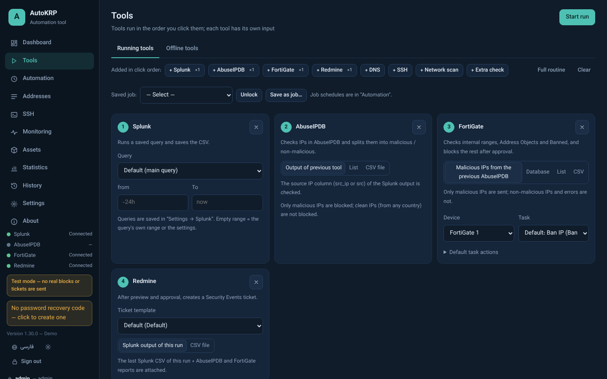
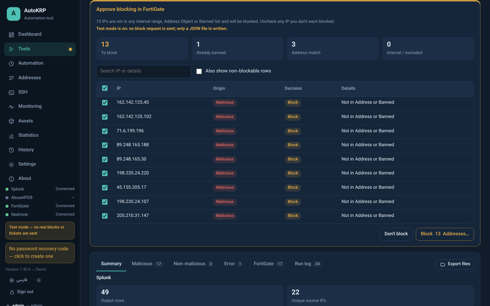
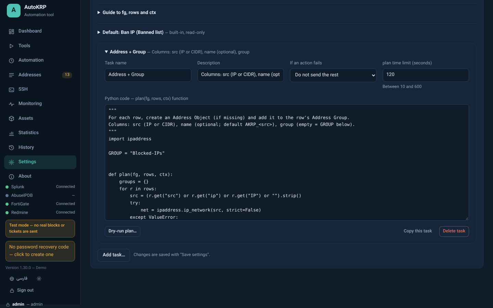
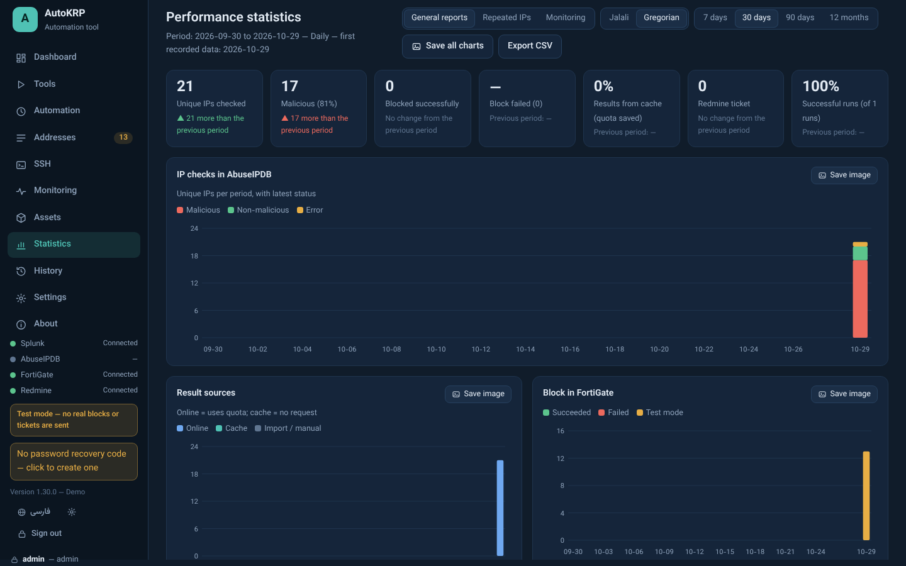

# AutoKRP

**Security response automation for Windows** — Splunk → AbuseIPDB → FortiGate → Redmine, plus SSH tooling, network monitoring and an encrypted credential vault, in one desktop or multi-user web app.

[](https://github.com/kamyar-rp/AutoKRP/releases/latest)
[](LICENSE)
[](https://github.com/kamyar-rp/AutoKRP/actions/workflows/security.yml)


**English** · [فارسی](README.fa.md)



---

## Why AutoKRP?

A typical SOC chore: take the source IPs from IDS alerts, check them on AbuseIPDB, block the malicious ones on the firewall and open a ticket. AutoKRP does this end to end — on demand or on a schedule — with a **preview and approval step before anything is changed**, a test mode that sends nothing, and every secret encrypted at rest.

## Features

**Response pipeline**
- Run a Splunk query, check the source IPs on AbuseIPDB (with a local cache and multiple API keys), block the malicious ones on FortiGate and create a Redmine ticket.
- A **Tools** page where tools run in the order you click them — Splunk, AbuseIPDB, FortiGate, Redmine, DNS, SSH, network scan, extra threat-feed check — each feeding the next as a **table** (CSV with named columns). Save an ordering as a **job** and schedule it.
- **Approval before any change**: the exact IPs, actions or requests are shown first; uncheck what you don't want. Test mode is on by default.
- Excluded ranges that are never checked or blocked; the app's own servers are added automatically.

**FortiGate**
- Several FortiGate devices, each with its own connection, token and certificate pin.
- Permanent or **temporary blocks** (in days): pick the duration when blocking from the Addresses list (also for IPs that are already blocked), or set rules such as "country is IR → 30 days, everything else permanent".
- **Python tasks**: write a `plan(fg, rows, ctx)` function that reads from the device and *proposes* actions (create an address, add it to a group, build a policy, …). AutoKRP shows the proposed requests and sends only the approved ones. Templates and a dry-run are included.
- Offline FortiGate signature updates over SSH/TFTP; a CLI log-search command builder.

**Device access (SSH, Telnet, console cable)**
- Script library with variables from the previous tool's output; run on many devices at once; the last command's output can be passed on as CSV.
- Scheduled config backups with version diff and "download latest of selected devices" as a zip; search, filter and bulk actions for many devices.
- Linux folder backup jobs: folders or files of a Linux server streamed over SSH as `tar.gz` (optional sudo, exclusions, keep the last N, scheduled); a single file or archive is saved as it is.
- Live terminal in tabs over SSH, Telnet or a USB/serial console cable (COM port, desktop mode only, with Break), MultiExec, saved command buttons, search in the terminal text (Ctrl+Shift+F) and saving the whole session log; WinSCP-style file transfer (SFTP, SCP, FTP/FTPS, temporary TFTP server) with a built-in text editor (syntax highlighting, find & replace, conflict check, optional previous versions).
- Telnet devices for runs and config backups (Cisco and other network devices supported by netmiko).
- Network tools: find where an IP/MAC is connected (switch and port, via SNMP ARP/MAC tables), traceroute, IP owner lookup (RDAP), MAC vendor lookup (IEEE).
- **API tool**: saved connections (base URL + Basic, Bearer or API-key auth; secrets in the encrypted store), GET/POST/PUT/PATCH/DELETE with parameters, headers and body, formatted JSON responses (copy or save), saved requests and a request log in the database (who, when, what; secrets masked).

**Monitoring and assets**
- Ping / TCP / HTTP monitoring with sound, browser and email alerts, maintenance windows, reports and a NOC view.
- **Block rules for non-malicious IPs** (attack days in a window, total attacks, score range, supplementary check, country, ISP) with their own block duration, the same approval path as malicious IPs and a fresh count after each block ends; filter the address list and block the result or save it as a rule.
- **Supplementary check sources** are editable: internet lists, a file on this computer or an uploaded file, line-by-line, CSV or IPsum format, with a test before saving.
- **Widget dashboards** like OpManager/Zabbix: several pages per dashboard, drag-and-resize widgets (status, problems, traffic and value charts, gauges, Top-N, availability, services table, response-time chart, status tiles, availability bar, SNMP table, maps, traps/syslog, clock, text); click a Ping/HTTP/TCP service for its chart and add it to a dashboard, shared or personal, slideshow and fullscreen.
- Hand-drawn **network maps** (no LLDP needed): port-to-port links coloured by load, red when a port or device is down, submaps, problems-only view and a wall-display mode.
- SNMP v2c/v3 (Cisco, FortiGate, Juniper, MikroTik, HP iLO, Linux, …): CPU, memory, disks, temperature, fans, PSUs, per-port traffic, custom OIDs, thresholds and long-term charts; traps and syslog. Polling runs in separate worker processes (multi-core), with monitoring policies per device (interval, 1- or 5-minute resolution, retention, what to collect) and optional MySQL/MariaDB storage for chart data and traps/syslog. Card or table view with saved per-user views, device display templates, and named NOC dashboards (tiles/table, uplink charts, auto-rotation) for wall displays.
- Asset inventory from SNMP (ENTITY-MIB) and SSH, with change history and admin approval.

**Everything else**
- Data in a local encrypted SQLCipher file, or on a separate **MySQL/MariaDB** or **PostgreSQL 16+** server (existing data is moved automatically; sensitive columns can stay encrypted).
- Statistics, repeated-IP analysis, full history, email notifications, offline tools (subnet calculator, hashes, IOC extractor, port list, …).
- Every section and sub-feature can be turned off for everyone (really stopped, not just hidden) or limited per user/group (hidden / view / run).
- English and Persian UI.

| Tools | Approval |
|---|---|
|  |  |
| **FortiGate Python task** | **Statistics** |
|  |  |

## Download and run

1. Download **`AutoKRP.exe`** from the [latest release](https://github.com/kamyar-rp/AutoKRP/releases/latest).
2. (Recommended) verify the file against the SHA-256 published with the release:
   ```powershell
   Get-FileHash .\AutoKRP.exe -Algorithm SHA256
   ```
3. Run it. The exe is not code-signed yet, so Windows SmartScreen may warn: **More info → Run anyway**.
4. On first run choose:
   - the **data folder** (default `%LOCALAPPDATA%\AutoKRP`), and
   - the **mode**: **Client** (desktop, one user on this PC) or **Server** (HTTPS web app for several users with admin / operator / read-only roles).

Just want to look around? Start it with `--demo` (or `run_demo.bat` from source): sample data, no real connections.

> Test mode is on by default: blocks, tickets and SSH changes are only written to the run log until you turn it off in **Settings → General**.

## Run from source

Requirements: Windows 10/11 and Python 3.11 or later.

```bat
git clone https://github.com/kamyar-rp/AutoKRP.git
cd AutoKRP
pip install -r requirements.txt
run_demo.bat      &rem sample data, no connections
run.bat           &rem normal start
```

| File | Purpose |
|---|---|
| `run_demo.bat` | Run with sample data |
| `run.bat` | Run normally |
| `build.bat` | Asks what to build (full, monitoring only, or your own choice of sections, and the mode), then builds the portable exe **and** the installer (isolated venv, `pip-audit`, SHA-256 next to each) |
| `build.bat full` | Everything, without questions: `dist\AutoKRP.exe` and `dist\AutoKRP-Setup-X.Y.Z.exe` |
| `build.bat portable` | Full build, portable exe only |
| `build.bat monitor` | Monitoring-only build: `dist\AutoKRP-Monitor.exe` (see "Modular builds") |

Command-line options: `AutoKRP.exe --help` (`--server`, `--client`, `--demo`, `--install-service`, `--local-db`, `--memdiag`, …).

### Installer (build it yourself)

Releases contain only the portable `AutoKRP.exe`. To get an installer (`C:\Program Files\AutoKRP`, Start menu,
uninstall entry), build it from source:

1. Put the build tools into `vendor\` as listed in [vendor/README.md](vendor/README.md): the Python 3.14 Windows
   installer (only if Python 3.14 is not installed) and the Inno Setup 6.3+/7 installer (only if Inno Setup is not
   installed). Nothing is installed system-wide.
2. Run `build.bat`. The output is `dist\AutoKRP-Setup-X.Y.Z.exe`.

The installed app **continues with the existing data**: it uses the same data folder as the portable exe for the same
Windows user. Running copies are closed before installing, and uninstalling never deletes data. If server auto-start
was set up from the portable exe, the server window offers **Update to this copy**.

### Modular builds (choose what goes into the exe)

`build.bat` can build an exe that contains only some sections, and only one run mode:

```bat
build.bat                           &rem menu: full / monitoring only / custom, then the mode
build.bat full                      &rem everything (the default; this is what releases contain)
build.bat monitor                   &rem monitoring only            -> dist\AutoKRP-Monitor.exe
build.bat monitor server            &rem monitoring only, server    -> dist\AutoKRP-Monitor-Server.exe
build.bat sec+dev client portable   &rem security + device access, client only, no installer
```

| Section | Contains |
|---|---|
| `sec` | Splunk, AbuseIPDB, FortiGate, Redmine, DNS, scan, extra check, Tools / Addresses / Automation pages, security dashboard and statistics |
| `dev` | SSH/Telnet devices and commands, config backup, Linux folder backup, terminal, file transfer, TFTP, serial console, network tools, API tool |
| `monitor` | Monitoring targets, SNMP, traps and syslog, maps, dashboards, NOC view, live check |
| `asset` | Assets and asset scan (keeps the SSH and SNMP engines it needs, not their pages) |
| `offline` | Offline tools and FortiGate offline update |

Modes: `both` (default; asked at first start), `client` (desktop only), `server` (web only).

Always included in every build: sign-in, users and groups, encryption and security settings, database (local,
MySQL/MariaDB, PostgreSQL), general settings, history and audit log, tasks and messages, notifications, updates check,
About, licence and author.

A section that is left out is not just hidden. Its engine code is replaced by empty stubs, its scripts are not shipped,
its API methods are removed, and its libraries (for example netmiko/paramiko without `dev`, pysnmp without `monitor`) are
not bundled. Anything a kept section needs from another one stays. The page markup in `index.html` is shared and stays
(hidden). A custom build has its own name (`AutoKRP-Monitor.exe`, own installer and install folder) but uses the **same
data folder**, so it continues with existing data; data of sections that are not in the build is left untouched.
The working tree is never changed: the source is staged in `build\stage\`. Details: `dev\mkbuild.py`, `autokrp\buildcfg.py`.

## Security

- All data is encrypted at rest: AES-256-GCM for settings and secrets, an SQLCipher database, encrypted run files and backups.
- Client mode protects the key with Windows DPAPI or a master password (with an optional recovery code); with a master password nothing — settings, database, backups or secrets — can be opened without it. Server mode wraps a master key per user; no DPAPI.
- HTTPS-only web mode with CSRF protection, strict CSP, lockouts and allowed networks.
- Nothing is blocked, ticketed or pushed to a device without approval unless you explicitly allow it for a scheduled job.

Details and how to report a vulnerability: [SECURITY.md](SECURITY.md).

## Contributing, bugs and ideas

- **Found a bug?** [Open a bug report](https://github.com/kamyar-rp/AutoKRP/issues/new?template=bug_report.yml).
- **Have an idea?** [Suggest a feature](https://github.com/kamyar-rp/AutoKRP/issues/new?template=feature_request.yml) or start a [discussion](https://github.com/kamyar-rp/AutoKRP/discussions).
- **Security issue?** Please report it privately — see [SECURITY.md](SECURITY.md).
- Pull requests are welcome; see [CONTRIBUTING.md](CONTRIBUTING.md).

## License

[MIT](LICENSE) © 2026 Kamyar RP. Built with the help of Claude (Anthropic).

Third-party components and their licenses: [THIRD_PARTY_NOTICES.md](THIRD_PARTY_NOTICES.md).
