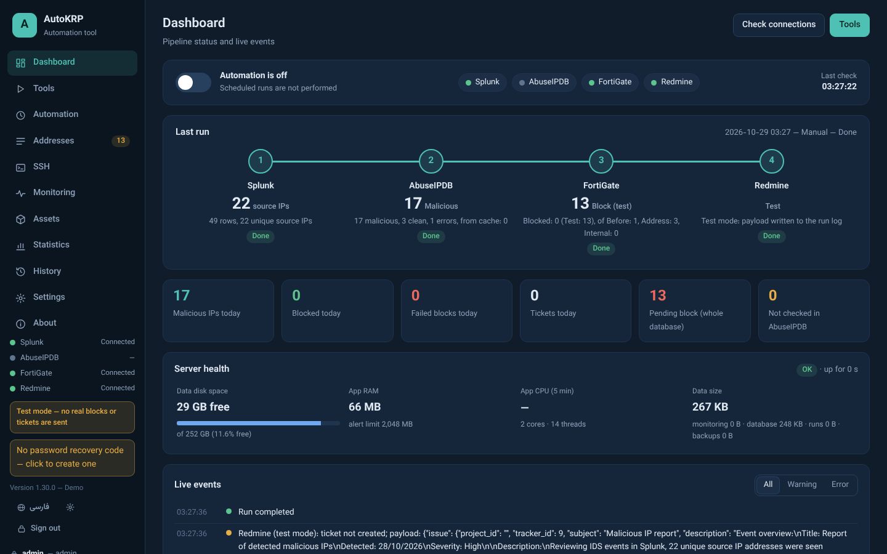
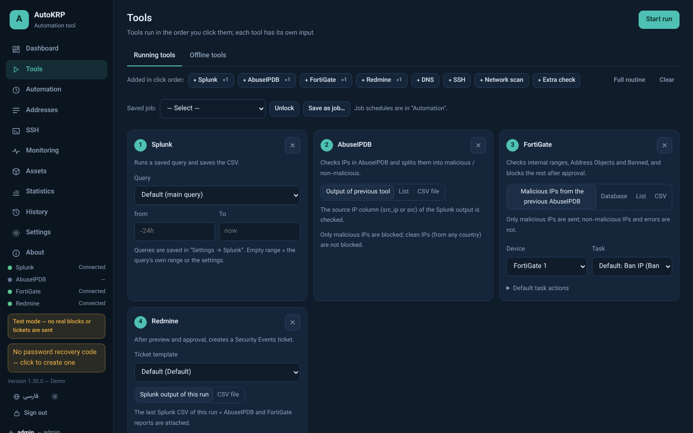
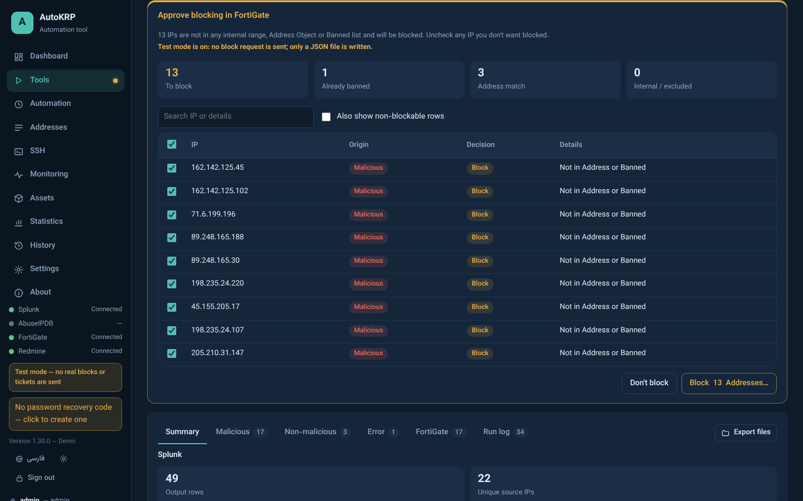
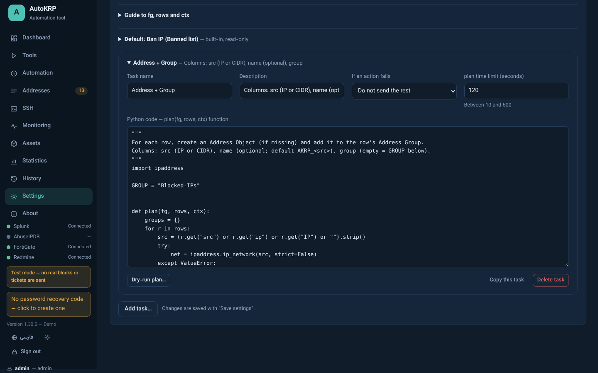
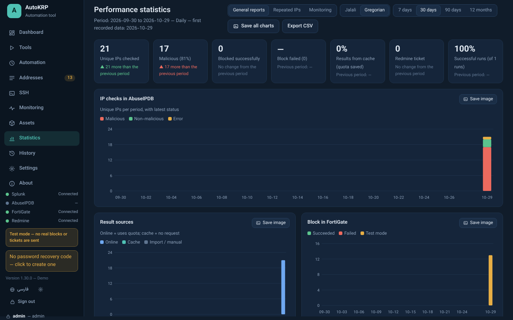

# AutoKRP

**Security response automation for Windows** — Splunk → AbuseIPDB → FortiGate → Redmine, plus SSH tooling, network monitoring and an encrypted credential vault, in one desktop or multi-user web app.

[](https://github.com/kamyar-rp/AutoKRP/releases/latest)
[](LICENSE)
[](https://github.com/kamyar-rp/AutoKRP/actions/workflows/security.yml)


**English** · [فارسی](README.fa.md)



---

## Why AutoKRP?

A typical SOC chore: take the source IPs from IDS alerts, check them on AbuseIPDB, block the malicious ones on the firewall and open a ticket. AutoKRP does this end to end — on demand or on a schedule — with a **preview and approval step before anything is changed**, a test mode that sends nothing, and every secret encrypted at rest.

## Features

**Response pipeline**
- Run a Splunk query, check the source IPs on AbuseIPDB (with a local cache and multiple API keys), block the malicious ones on FortiGate and create a Redmine ticket.
- A **Tools** page where tools run in the order you click them — Splunk, AbuseIPDB, FortiGate, Redmine, DNS, SSH, network scan, extra threat-feed check — each feeding the next as a **table** (CSV with named columns). Save an ordering as a **job** and schedule it.
- **Approval before any change**: the exact IPs, actions or requests are shown first; uncheck what you don't want. Test mode is on by default.
- Excluded ranges that are never checked or blocked; the app's own servers are added automatically.

**FortiGate**
- Several FortiGate devices, each with its own connection, token and certificate pin.
- **Python tasks**: write a `plan(fg, rows, ctx)` function that reads from the device and *proposes* actions (create an address, add it to a group, build a policy, …). AutoKRP shows the proposed requests and sends only the approved ones. Templates and a dry-run are included.
- Offline FortiGate signature updates over SSH/TFTP; a CLI log-search command builder.

**Device access (SSH, Telnet, console cable)**
- Script library with variables from the previous tool's output; run on many devices at once; the last command's output can be passed on as CSV.
- Scheduled config backups with version diff and "download latest of selected devices" as a zip.
- Live terminal in tabs over SSH, Telnet or a USB/serial console cable (COM port, desktop mode only, with Break), MultiExec and saved command buttons; WinSCP-style file transfer (SFTP, SCP, FTP/FTPS, temporary TFTP server).
- Telnet devices for runs and config backups (Cisco and other network devices supported by netmiko).
- Network tools: find where an IP/MAC is connected (switch and port, via SNMP ARP/MAC tables), traceroute, IP owner lookup (RDAP), MAC vendor lookup (IEEE).
- **API tool**: saved connections (base URL + Basic, Bearer or API-key auth; secrets in the encrypted store), GET/POST/PUT/PATCH/DELETE with parameters, headers and body, formatted JSON responses (copy or save), saved requests and a request log in the database (who, when, what; secrets masked).

**Monitoring and assets**
- Ping / TCP / HTTP monitoring with sound, browser and email alerts, maintenance windows, reports and a NOC view.
- Hand-drawn **network maps** (no LLDP needed): port-to-port links coloured by load, red when a port or device is down, submaps, problems-only view and a wall-display mode.
- SNMP v2c/v3 (Cisco, FortiGate, Juniper, MikroTik, HP iLO, Linux, …): CPU, memory, disks, temperature, fans, PSUs, per-port traffic, custom OIDs, thresholds and long-term charts; traps and syslog. Polling runs in separate worker processes (multi-core), with monitoring policies per device (interval, 1- or 5-minute resolution, retention, what to collect) and optional MySQL/MariaDB storage for chart data and traps/syslog. Card or table view with saved per-user views, device display templates, and named NOC dashboards (tiles/table, uplink charts, auto-rotation) for wall displays.
- Asset inventory from SNMP (ENTITY-MIB) and SSH, with change history and admin approval.

**Everything else**
- Statistics, repeated-IP analysis, full history, email notifications, offline tools (subnet calculator, hashes, IOC extractor, port list, …).
- Every section and sub-feature can be turned off for everyone (really stopped, not just hidden) or limited per user/group (hidden / view / run).
- English and Persian UI.

| Tools | Approval |
|---|---|
|  |  |
| **FortiGate Python task** | **Statistics** |
|  |  |

## Download and run

1. Download **`AutoKRP.exe`** from the [latest release](https://github.com/kamyar-rp/AutoKRP/releases/latest).
2. (Recommended) verify the file against the SHA-256 published with the release:
   ```powershell
   Get-FileHash .\AutoKRP.exe -Algorithm SHA256
   ```
3. Run it. The exe is not code-signed yet, so Windows SmartScreen may warn: **More info → Run anyway**.
4. On first run choose:
   - the **data folder** (default `%LOCALAPPDATA%\AutoKRP`), and
   - the **mode**: **Client** (desktop, one user on this PC) or **Server** (HTTPS web app for several users with admin / operator / read-only roles).

Just want to look around? Start it with `--demo` (or `run_demo.bat` from source): sample data, no real connections.

> Test mode is on by default: blocks, tickets and SSH changes are only written to the run log until you turn it off in **Settings → General**.

## Run from source

Requirements: Windows 10/11 and Python 3.11 or later.

```bat
git clone https://github.com/kamyar-rp/AutoKRP.git
cd AutoKRP
pip install -r requirements.txt
run_demo.bat      &rem sample data, no connections
run.bat           &rem normal start
```

| File | Purpose |
|---|---|
| `run_demo.bat` | Run with sample data |
| `run.bat` | Run normally |
| `build.bat` | Build `dist\AutoKRP.exe` (isolated venv, `pip-audit`, SHA-256 next to the exe) |

Command-line options: `AutoKRP.exe --help` (`--server`, `--client`, `--demo`, `--install-service`, `--local-db`, `--memdiag`, …).

## Security

- All data is encrypted at rest: AES-256-GCM for settings and secrets, an SQLCipher database, encrypted run files and backups.
- Client mode protects the key with Windows DPAPI or a master password (with an optional recovery code). Server mode wraps a master key per user; no DPAPI.
- HTTPS-only web mode with CSRF protection, strict CSP, lockouts and allowed networks.
- Nothing is blocked, ticketed or pushed to a device without approval unless you explicitly allow it for a scheduled job.

Details and how to report a vulnerability: [SECURITY.md](SECURITY.md).

## Contributing, bugs and ideas

- **Found a bug?** [Open a bug report](https://github.com/kamyar-rp/AutoKRP/issues/new?template=bug_report.yml).
- **Have an idea?** [Suggest a feature](https://github.com/kamyar-rp/AutoKRP/issues/new?template=feature_request.yml) or start a [discussion](https://github.com/kamyar-rp/AutoKRP/discussions).
- **Security issue?** Please report it privately — see [SECURITY.md](SECURITY.md).
- Pull requests are welcome; see [CONTRIBUTING.md](CONTRIBUTING.md).

## License

[MIT](LICENSE) © 2026 Kamyar RP. Built with the help of Claude (Anthropic).

Third-party components and their licenses: [THIRD_PARTY_NOTICES.md](THIRD_PARTY_NOTICES.md).
